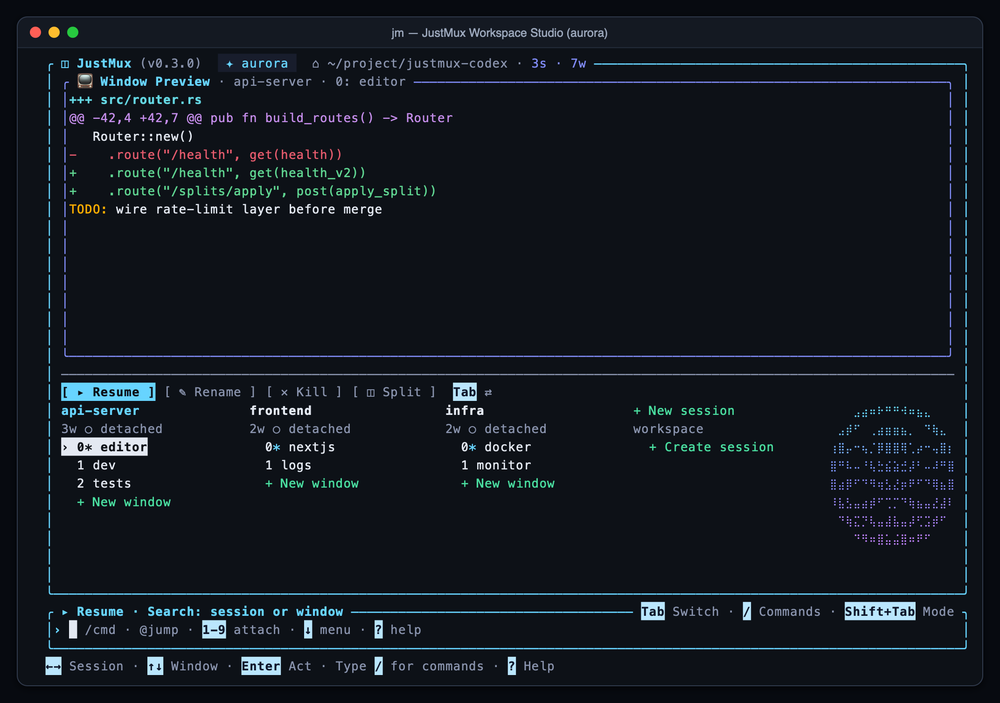

<div align="center">

# ◫ JustMux (`jm`)

### tmux is awesome. Prefix gymnastics aren't.

**Stop memorizing `Ctrl+b %`, `Ctrl+b "`, `Ctrl+b s`, and `Ctrl+b q`. Just type `/`.**

[](https://www.npmjs.com/package/justmux)
[](LICENSE)
[](#get-started-in-15-seconds)
[](#inside-the-box)

**English** · [简体中文](README.zh-CN.md)

```sh
npm install -g justmux@latest
jm
```

<br />



</div>

---

## Why tmux users switch to `jm` in 5 minutes

We all love tmux's persistence—until real life gets messy:

- **"Which of my 6 detached sessions has the failing server log?"**
  Normally you attach, squint, detach, repeat. JustMux gives you a **live colored terminal preview** of every window *before* you enter it—complete with scrollback history (`PgUp`/`PgDn`/mouse wheel).
- **"Splitting into a clean 2×2 workspace shouldn't feel like origami."**
  Skip chaining `Ctrl+b %`, `Ctrl+b "`, and panicking when a split lands in the wrong half. Open `/split` to get an interactive **2×2 Visual Split Studio**—slice panes with mouse or keyboard, preview live windows inside each tile, hit `Enter`, and drop straight into the finished tmux layout.
- **"I'm mid-prompt inside Vim, Claude Code, Codex CLI, or agy—I don't want to quit just to hop windows."**
  Tap one optional popup shortcut (**`Ctrl+b j`**): `jm` floats cleanly above your fullscreen app, switches you with native `switch-client` when you pick a window, or disappears on `Esc` without touching the running process below.
- **"I don't want plugins, daemons, or anything touching my `~/.tmux.conf`."**
  JustMux is a single fast Rust binary on top of the tmux server you already run. No background daemon, no database, zero config required, and it never touches your dotfiles unless you ask.

---

## See it in action

### 1. Visual 2×2 Split Studio — VS Code feel inside your terminal

Type `/split` (or tab to `[ ◫ Split ]` on Home) to stage up to **2 columns × 2 rows** visually before touching a single live tmux pane:

<div align="center">
  
</div>

- **Slice visually, click or type:** Pick any pane tile with **`1`–`4`**, **`Tab`**, or a **mouse click**; split sideways with **`h`** (`|`), vertically with **`v`** (`-`), transpose the whole grid with **`t`**, remove a tile with **`x`**, or reset to 1×1 with **`r`**.
- **Fill panes with real running windows:** Arrow up/down (or click any row) to pour existing windows into the active tile—or keep `+ New shell` for a fresh terminal. Already-placed windows **never get stolen accidentally** while browsing; press **`Space`** or **click** to cleanly swap tiles.
- **Scroll live ANSI previews right inside the tiles:** Catch up on logs via mouse wheel hover, **`PgUp`/`PgDn`**, **`Home`/`End`**, or **`Ctrl+U`/`Ctrl+D`**.
- **Zero-regret preview:** Press **`Enter`** (or click `[Enter] Apply & Enter`) and JustMux runs native `join-pane` / `split-window`, **focuses the exact pane you highlighted** (`#3 ★`), and puts you right inside tmux. Press **`Esc`** to back out with zero changes.

---

### 2. Stop memorizing key chords — just type `/`

Forgot the command? Type **`/`** (or press **`↓`** on an empty bar, or **`Ctrl+P`** anywhere) for a searchable, typo-forgiving palette:

<div align="center">
  
</div>

- **Three instant home modes (`Shift+Tab`):** Switch between **Command & `@Jump`** (default matrix + `1–9` direct keys), **Live Radar** (session list + huge preview), and **Quick Launch** (press `Enter` to spin up a workspace for your current folder).
- **`@` target autocomplete anywhere:** Type `@`, `/kill @`, `/rename @`, or `/split @` to jump straight to `@session`, `@session:window`, or `@session:window.pane`.
- **Natural phrases & forgiving typos:** `new api`, `split right`, `split down`, `kill demo`, or even bare `resume` all just work—and destructive kills always pause on an explicit `yes` Approval Card.
- **Tucked-away Easter eggs:** Try `/codex`, `/claude`, `/antigravity`, `/vibe`, or hit `Ctrl+b` on the home screen for a quiet nod to muscle memory.

---

### 3. Five TrueColor themes & native English / 简体中文 UI

Press **`Ctrl+T`** anytime to cycle palettes—from **Antigravity Aurora** and **Codex Emerald** to **Claude Warmth**, **Cyber Matrix**, and **Classic**—or open **`/theme`** to live-preview before saving (`s`), and toggle **English / 简体中文** live inside **`/config`**:

<table>
  <tr>
    <td width="50%">
      
      <p align="center"><sub><code>/theme</code> — Live palette switcher + 1-key save to <code>config.toml</code></sub></p>
    </td>
    <td width="50%">
      
      <p align="center"><sub><code>language = "zh"</code> + <code>Codex Emerald</code> theme in 2×2 Split Studio</sub></p>
    </td>
  </tr>
</table>

---

## Get started in 15 seconds

### Install via npm (prebuilt binary, no Rust needed)

```sh
npm install -g justmux@latest
jm        # or: justmux
```

> Both `jm` and `justmux` launch the exact same native Rust executable (the thin Node launcher `execve`s straight into the binary and exits). Update anytime with **`jm update`**. Supports **macOS Apple Silicon** and **Linux x64** (static musl).

### Or install from source with Cargo (Rust 1.88+)

```sh
cargo install --path . --locked
```

---

## Pro tip: Pop up `jm` over Vim, Codex, Claude Code, or agy

Already deep inside a fullscreen TUI inside tmux? Don't quit your app. Run `jm --print-keybind` or drop this one line into `~/.tmux.conf` (tmux 3.2+):

```tmux
bind-key j run-shell 'tmux display-popup -E -w 80% -h 70% -c #{q:client_name} "JUSTMUX_CLIENT=#{q:client_name} JUSTMUX_PANE=#{q:pane_id} JUSTMUX_POPUP=1 jm"'
```

Reload tmux once (`tmux source-file ~/.tmux.conf`), then press **`Ctrl+b` → `j`** from inside *any* program:

1. `jm` pops open cleanly over your terminal.
2. Pick another window—or assemble a 2×2 layout in `/split`—and press **`Enter`** to switch there cleanly.
3. Or hit **`Esc`** to dismiss the popup and go straight back to what you were typing.

---

## Quick cheat sheet

| You want to… | Just type or press |
| --- | --- |
| Jump straight to workspace 1–9 | `1`–`9` (on an empty bar) or `Enter` |
| Open the 2×2 Visual Split Studio | `/split` (or `Tab` to `[Split]`, or `/split @name`) |
| Arrange panes inside Split Studio | `1-4`/`Tab`/Click focus · `h` split H · `v` split V · `t` flip · `x` del · `r` reset · `Space` swap |
| Scroll live pane output | `PgUp` / `PgDn` · `Home` / `End` · `Ctrl+U` / `Ctrl+D` · Mouse Wheel |
| Switch Home Studio view | `Shift+Tab` (`Command & @Jump` / `Live Radar` / `Quick Launch`) |
| Open command palette anywhere | `/` · `↓` · `Ctrl+P` · `Ctrl+K` (outside text inputs) |
| Switch colors / open settings | `Ctrl+T` / `/theme` / `/config` (`s` saves to `~/.config/justmux/config.toml`) |
| Detach vs leave JustMux | `/exit` (detach tmux client) · `/quit` or `Esc` (exit `jm`) |

---

## Inside the box

<details>
<summary><strong>Requirements, inline mode, custom sockets & auto-update details</strong></summary>

- **Runtime requirements:** `tmux` (`3.2+` recommended for `display-popup`, `brew install tmux` or `apt install tmux`), Node.js `22.15+` (Node 24 LTS recommended) for global npm install, and a UTF-8 terminal on macOS ARM64 or Linux x64.
- **Native `--inline` scrollback mode:** Prefer keeping your native terminal history intact? Run `jm --inline` (or set `screen_mode = "inline"` in `/config`). Respects `NO_COLOR=1`, `TERM=dumb`, and `--ascii`.
- **Unified TOML config:** Zero-dependency TOML at `~/.config/justmux/config.toml` (`CLI > Env > config.toml > defaults`). Generate a starter with `jm --print-config`, or inspect your setup with `jm doctor`. See [`docs/configuration.md`](docs/configuration.md).
- **Custom sockets:** Pass `jm -L NAME` or `jm -S /path/to/socket` just like tmux. Outside tmux it replaces itself with `tmux attach-session`; inside tmux it switches only the launching client.
- **Daily update check (global npm only):** Checks npm at most once per day for interactive launches (disable with `JUSTMUX_NO_UPDATE_CHECK=1`, or run `jm update --check` / `jm update`).

</details>

<details>
<summary><strong>For contributors: building, testing & local releases</strong></summary>

All tmux integration tests run against private sockets and clean up automatically—they never touch your default tmux server or `~/.tmux.conf`. See [`docs/manual-test.md`](docs/manual-test.md) and [`assets/demo.cast`](assets/demo.cast) for real PTY smoke checks and manual verification checklists.

```sh
export PATH="$HOME/.cargo/bin:$PATH"
cargo fmt --all -- --check
cargo clippy --all-targets --all-features -- -D warnings
cargo test --all
cargo build --release
```

Packaging, npm wrapper, and release workflow tests live in [`docs/npm-release.md`](docs/npm-release.md) and [`docs/local-release.md`](docs/local-release.md):

```sh
npm --prefix npm/justmux test
node --test tests/npm-packages.test.mjs tests/release-workflow.test.mjs
python3 scripts/pty_smoke.py
```

</details>

## License

MIT © [Quaternijkon](https://github.com/Quaternijkon/justmux)
