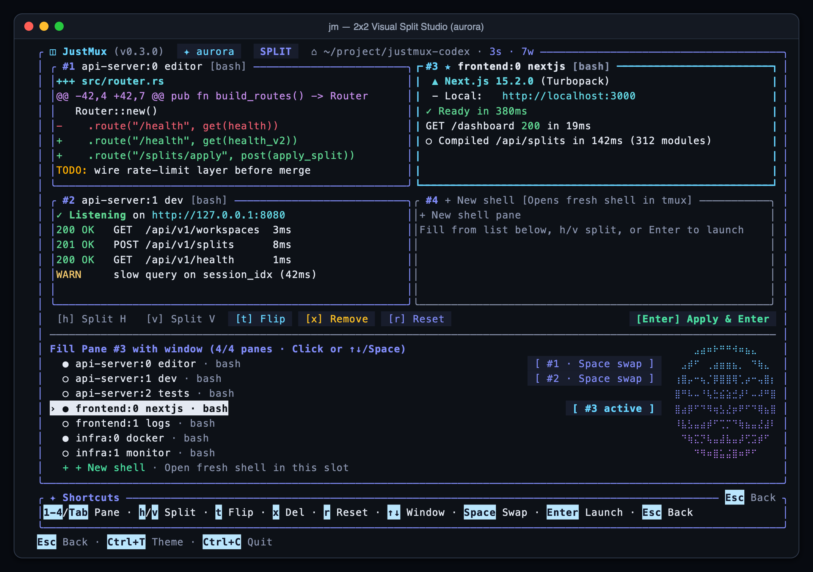
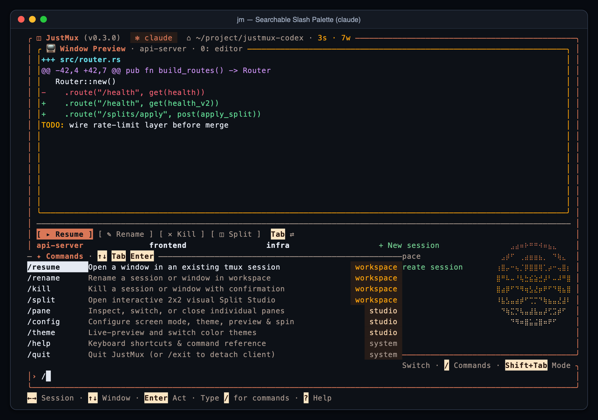
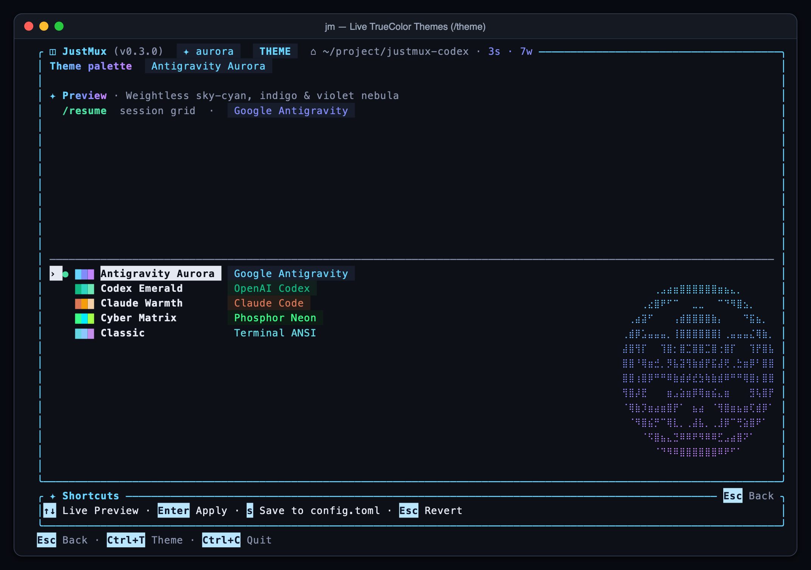
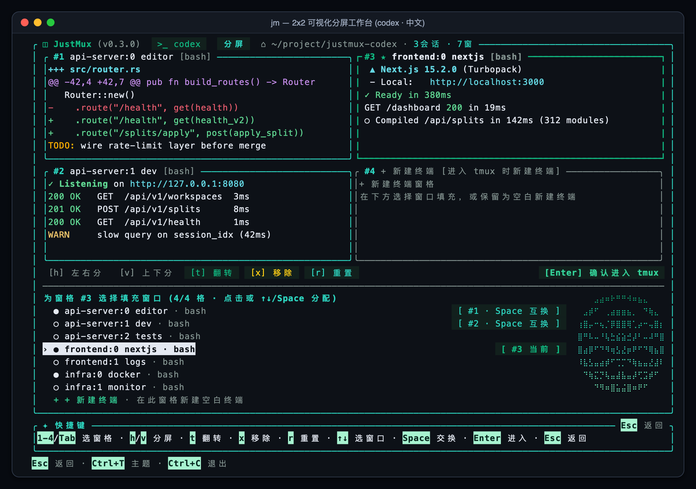

<div align="center">

# ◫ JustMux (`jm`)

### tmux is awesome. Prefix gymnastics aren't.

**Stop memorizing `Ctrl+b %`, `Ctrl+b "`, `Ctrl+b s`, and `Ctrl+b q`. Just type `/`.**

[](https://www.npmjs.com/package/justmux)
[](LICENSE)
[](#get-started-in-15-seconds)
[](#inside-the-box)

**English** · [简体中文](README.zh-CN.md)

```sh
curl -fsSL https://raw.githubusercontent.com/Quaternijkon/justmux/main/install.sh | sh
# Or via npm (Node.js 22.15+):
npm install -g justmux@latest
jm
```

<br />


</div>

---

## Why tmux users switch to `jm` in 5 minutes

We all love tmux's persistence—until real life gets messy:

- **"Which of my 6 detached sessions has the failing server log?"**
  Normally you attach, squint, detach, repeat. JustMux gives you a **live auto-streaming colored terminal preview** of every window and pane *before* you enter it—complete with a **VS Code scrollbar** marking search matches (amber) and `ERROR`/`FATAL`/`panic` lines (red), **drag-to-select copy**, **`[`/`]` multi-pane cycling**, live **search (`f`)**, **`y` clipboard copy**, log export/`pipe-pane`, and a **Mission Control (`/expose`, `Ctrl+G` / `F3`)** live multi-window wall with output-velocity **Sparklines**.
- **"Can I type straight into a background pane without even leaving the dashboard?"**
  Click **`[⌨ PIP]`** on the top IDE menubar (or **`[⌨]`** on any preview card / Exposé tile, or press **`i`** in `/expose`) to enter **Live PIP direct type-through**: type commands, paste text, or send `Ctrl+C` straight into the pane at 80ms refresh while watching it respond live—then hit **`Esc`** to step right back out (or click **`[Send Esc]`** to forward a literal Escape).
- **"Splitting, resizing, and arranging panes shouldn't feel like origami."**
  Skip chaining `Ctrl+b %`, `Ctrl+b "`, `Ctrl+b Alt+1..5`, and `Ctrl+b z`. **Drag any window** onto the **Left / Right / Top / Bottom edge dock zones** of a preview card, Split Studio tile, or Exposé tile to dock-split on the spot—or drag **Split Sashes** directly with your mouse! Open **`/split`** to stage or **edit existing multi-pane windows** (`50/50 · 70/30 · 30/70` ratios, quick grid presets, **`y` broadcast sync**, **`b` break-out**), or **`/layout`** for visual layout cards and live pane resizing.
- **"Why are there dotted borders around my tmux screen, or how do I save my whole dev setup?"**
  Open **`/clients`** to see every attached client's resolution and hit **`d`** (or **`o`**) to detach stale/smaller clients in one keystroke (or pick **Attach Read-Only** to observe safely). Use **`/buffers`** to browse, copy, and paste tmux paste buffers, and **`/snapshot`** to save and restore multi-session layouts (windows, pane directories, titles, layouts, and sync state) as clean TOML templates.
- **"I'm mid-prompt inside Vim, Claude Code, Codex CLI, or agy—I don't want to quit just to hop windows."**
  Enable **`tmux_popup`** right inside **`/config`** (or drop `jm --print-keybind` into `~/.tmux.conf`) and tap **`Ctrl+b j`**: `jm` floats cleanly above your fullscreen app, switches you with native `switch-client` when you pick a window, or disappears on `Esc` without touching the running process below. Need a quick floating shell? Run **`/popup`** (tmux 3.2+).
- **"I don't want plugins, daemons, or anything touching my `~/.tmux.conf` without asking."**
  JustMux is a single fast Rust binary on top of the tmux server you already run. No background daemon, no database, zero config required, and it never touches your dotfiles unless you explicitly toggle **`tmux_popup`** or opt-in comfort defaults (**`tmux_mouse`**, **`tmux_history_limit`**, **`tmux_base_index_one`**, **`tmux_renumber_windows`**, **`tmux_zero_escape_time`**) inside **`/config`**.

---

## See it in action

### 1. Visual 2×2 Split Studio — VS Code feel inside your terminal

Type `/split` (or tab to `[ ◫ Split ]` on Home) to stage up to **2 columns × 2 rows** visually before touching a single live tmux pane:

<div align="center">
  
</div>

- **Slice visually, edit existing layouts, or pick presets:** Pick any pane tile with **`1`–`4`**, **`Tab`**, or a **mouse click**; split sideways with **`h`** (`|`), vertically with **`v`** (`-`), transpose with **`t`**, cycle split ratios with **`p`** (`50/50 · 70/30 · 30/70`) or fine-tune ±5% with **`[`/`]`**, cycle quick grid presets with **`g`** (`1×2`, `2×1`, `Main+2`, `2×2`), remove a tile with **`x`**, or reset with **`r`**. Opening `/split` on a window that already has 2–4 panes loads its real layout for visual editing—including **`b`** to break a pane out into its own window!
- **Fill panes with real running windows & broadcast safely:** Arrow up/down (or click any row) to pour existing windows into the active tile—or keep `+ New shell` for a fresh terminal. Already-placed windows **never get stolen accidentally** while browsing; press **`Space`** or **click** to swap tiles, and press **`y`** to toggle **`synchronize-panes`** (with a bright warning banner whenever broadcast input is active).
- **Scroll live ANSI previews right inside the tiles:** Catch up on logs via mouse wheel hover, **`PgUp`/`PgDn`**, **`Home`/`End`**, or **`Ctrl+U`/`Ctrl+D`**.
- **Zero-regret preview:** Press **`Enter`** (or click `[Enter] Apply & Enter`) and JustMux runs native `join-pane` / `split-window` / `resize-pane`, **focuses the exact pane you highlighted** (`#3 ★`), and puts you right inside tmux. Press **`Esc`** to back out with zero changes.

---

### 2. Desktop-grade terminal GUI & zero-memorization tmux controller

JustMux feels like a native IDE right inside your terminal—with a **Top IDE Menubar** (`[⌂ Studio]` · `[⊞ Expose]` · `[◫ Split]` · `[▦ Layout]` · `[≡ Menu ▾]` on the left; live activity **Sparkline**, `[⌨ PIP]`, `[🎨]`, 1-click `[中/EN]`, `[⚙]`, and `[⏏]` on the right), full desktop mouse gestures, and a searchable **`/`** palette (`↓` or `Ctrl+P` anywhere):

<div align="center">
  
</div>

- **Desktop mouse gestures, drag & drop & floating overlays:**
  - **Single-click** focuses and refreshes previews without accidental jumps; **double-click (`<= 350ms`)** enters tmux immediately; **middle-click** opens the `yes` close confirmation (or removes a Split Studio slot); **right-click** anywhere opens a **2D drop-shadow floating context menu** with keyboard & mouse support.
  - **VS Code Drag & Drop + Floating Ghost Card:** Drag windows across sessions (`move-window`), reorder windows within a session (`swap-window`), or drag onto **Left / Right / Top / Bottom / Center edge dock zones** of the Preview Card, Split Studio tiles, or Exposé tiles to split cleanly—and drag **Split Sashes** directly in Home, `/split`, and `/layout` with a live `64% │ 36%` percentage badge.
  - **VS Code Scrollbar, Drag-to-Select & Inline Rename:** Click or drag the preview scrollbar (annotated with amber search ticks and red `ERROR`/`FATAL`/`panic`/`FAIL` ticks), click-drag inside preview output to highlight and copy text directly to clipboard, press **`F2`** (or click **`[✎]`**) for an inline rename popover, and get non-blocking **Toast notifications** with countdown progress bars.
- **Mission Control (`/expose`, `Ctrl+G`, `F3`) & Live PIP Direct Input:**
  - Open **`/expose`** for a live `1×1`–`3×3` multi-window SGR streaming wall with per-tile output-velocity **Sparklines (`▁▂▃▅▇█`)**, status badges, and hover-colored window controls **`[⌨][⛶][✕]`**.
  - Activate **Live PIP** (`[⌨ PIP]` menubar pill, `[⌨]` preview/tile button, or **`i`** in `/expose`) to forward keystrokes, bracketed paste, and `Ctrl+C` straight into any background pane while watching live output—press **`Esc`** to exit PIP or click **`[Send Esc]`** to send literal Escape.
- **Three instant home modes (`Shift+Tab`) & live status badges:** Switch between **Command & `@Jump`** (matrix + `1–9` direct keys + status badges for `⛶` zoom, `⚡SYNC`, `●`/`🔔`/`💤` activity/bell/silence, `✕` dead panes, and `👥 N` multi-client), **Live Radar**, and **Quick Launch**. When a window has multiple panes, press **`[`/`]`** (or click **`◀`/`▶`**) to cycle live previews across every pane without leaving Home.
- **Inspect, search, copy & record live output:** On any preview card, press **`f`** to search scrollback (`n`/`N` to jump matches), **`y`** to copy directly to your OS clipboard (`pbcopy`/`wl-copy`/`xclip`/`xsel`, with automatic tmux buffer fallback over SSH), or click **`[Log]`** / **`[Pipe]`** to export sanitized plain-text logs or toggle live `pipe-pane` streaming.
- **Dedicated visual studios for every tricky tmux workflow:**
  - **`/expose`** — Mission Control live multi-window preview wall with Sparklines, Live PIP (`i`), zoom (`z`), inline rename (`F2`), and drag-docking.
  - **`/layout`** — 5 visual layout preset cards (`Even Horizontal`, `Even Vertical`, `Main Horizontal`, `Main Vertical`, `Tiled`) + live arrow-key & draggable-sash **`resize-pane`** HUD + **`z`** zoom & **`s`** sync toggles.
  - **`/clients`** — Inspect attached clients & dimensions, press **`d`** (or **`o`**) to **detach all other clients** (instant dotted-border fix), **`x`** to detach a selected client, or pick **Attach Read-Only** (`attach -r`) from session actions.
  - **`/buffers`** — Browse tmux paste buffers with full scrollable preview, copy to system clipboard (`y`), paste into any chosen pane (`Enter`), create (`n`), or delete (`x`).
  - **`/snapshot`** — Save (`n`) and restore (`Enter`) workspace templates (sessions, windows, pane working directories, titles, layouts, and `synchronize-panes`) as clean zero-dependency TOML files.
  - **`/pane` & `/window`** — Full action menus for zoom/unzoom, break/swap/join pane, move/link/reorder window, cycle activity/silence monitoring, send `Ctrl+C` or commands (`send-keys`), clear scrollback, respawn dead panes, rename pane titles, and create windows with optional working directory (`Tab`).
  - **`/popup` & `/kill-server`** — Launch a native floating scratchpad shell (tmux 3.2+), or cleanly stop the tmux server behind a strict `yes` confirmation card.
- **`@` target autocomplete & natural phrases:** Type `@`, `/kill @`, `/rename @`, `/split @`, or `/layout @` to target `@session`, `@session:window`, or `@session:window.pane`, or type plain phrases like `expose`, `mission control`, `zoom`, `break pane`, `sync panes`, `detach others`, `clients`, `buffers`, `save workspace`, `restore workspace`, `reload tmux`, or `popup`—and destructive actions always pause on an explicit `yes` Approval Card.
- **Tucked-away Easter eggs:** Try `/codex`, `/claude`, `/antigravity`, `/vibe`, or hit `Ctrl+b` on the home screen for a quiet nod to muscle memory.

---

### 3. Five TrueColor themes & native English / 简体中文 UI

Press **`Ctrl+T`** anytime to cycle palettes—from **Antigravity Aurora** and **Codex Emerald** to **Claude Warmth**, **Cyber Matrix**, and **Classic**—or open **`/theme`** to live-preview before saving (`s`), and toggle **English / 简体中文** live inside **`/config`**:

<table>
  <tr>
    <td width="50%">
      
      <p align="center"><sub><code>/theme</code> — Live palette switcher + 1-key save to <code>config.toml</code></sub></p>
    </td>
    <td width="50%">
      
      <p align="center"><sub><code>language = "zh"</code> + <code>Codex Emerald</code> theme in 2×2 Split Studio</sub></p>
    </td>
  </tr>
</table>

---

## Get started in 15 seconds

### One-line standalone installer (no Node.js or Rust needed)

```sh
curl -fsSL https://raw.githubusercontent.com/Quaternijkon/justmux/main/install.sh | sh
jm        # or: justmux
```

> Downloads the prebuilt platform binary (**macOS Apple Silicon** or **Linux x64** static musl), verifies its SHA-256 checksum, and installs `jm` and `justmux` directly into a writable directory on your `PATH` (falling back to `~/.local/bin` and configuring your shell profile if needed).

### Or install via npm (Node.js 22.15+)

```sh
npm install -g justmux@latest
jm        # or: justmux
```

> Both `jm` and `justmux` launch the exact same native Rust executable (the thin Node launcher `execve`s straight into the binary and exits). During installation, a local-only `postinstall` helper ensures `jm` and `justmux` are linked into `<prefix>/bin` and reachable on your `PATH` (if your npm global prefix isn't in `PATH`, it symlinks them into a writable standard `PATH` directory such as `/usr/local/bin` or `~/.local/bin` without overwriting existing commands). If you pass `--ignore-scripts`, or use `pnpm` / `bun`, and encounter `command not found`, add `$(npm prefix -g)/bin` to your `PATH` or use the standalone installer above. Update anytime with **`jm update`**. Supports **macOS Apple Silicon** and **Linux x64** (static musl).

### Or install from source with Cargo (Rust 1.88+)

```sh
cargo install --path . --locked
```

---

## Pro tip: Pop up `jm` over Vim, Codex, Claude Code, or agy

Already deep inside a fullscreen TUI inside tmux? Don't quit your app.

**One-click setup inside JustMux:** Open **`/config`**, move to **`tmux_popup`**, and press **`Space`** / **`Enter`**. JustMux safely writes a clearly delimited block into `~/.tmux.conf` (or your existing `~/.config/tmux/tmux.conf`) and hot-reloads any running tmux server—and toggling it back to `false` removes only that managed block without touching the rest of your file. While you're in **`/config`**, you can also enable beginner-friendly opt-in tmux comfort toggles (**`tmux_mouse`**, **`tmux_history_limit`**, **`tmux_base_index_one`**, **`tmux_renumber_windows`**, **`tmux_zero_escape_time`**) or press **`Enter`** on **`tmux_reload`** to live-reload `~/.tmux.conf`.

Or set it up manually via `jm --print-keybind` (`~/.tmux.conf`, tmux 3.2+):

```tmux
bind-key j run-shell 'tmux display-popup -E -w 80% -h 70% -c #{q:client_name} "JUSTMUX_CLIENT=#{q:client_name} JUSTMUX_PANE=#{q:pane_id} JUSTMUX_POPUP=1 jm"'
```

Then press **`Ctrl+b` → `j`** from inside *any* program or shell:

1. `jm` pops open cleanly over your terminal.
2. Pick another window—or assemble a 2×2 layout in `/split`—and press **`Enter`** to switch there cleanly.
3. Or hit **`Esc`** to dismiss the popup and go straight back to what you were typing.

---

## Quick cheat sheet

| You want to… | Just type or press |
| --- | --- |
| Jump straight to workspace 1–9 | `1`–`9` (on an empty bar), `Enter`, or **Double-Click** (`<= 350ms`) |
| Open Mission Control live window wall | `/expose` · `Ctrl+G` · `F3` · click `[⊞ Expose]` (`i` PIP · `z` zoom · `F2` rename · `x` kill) |
| Type directly into a background pane (Live PIP) | `F4` · click `[⌨ PIP]` / `[⌨]` (or `i` in `/expose`) · type/paste/`Ctrl+C` · `Esc` exits (`[Send Esc]` forwards Esc) |
| Desktop mouse gestures & VS Code drag-drop | **Right-Click** context menu · **Middle-Click** close · **Drag** to move/swap/edge-dock · **Drag Sash** to resize |
| Inline rename session / window / pane title | `F2` or click `[✎]` |
| Open the 2×2 Visual Split Studio | `/split` (or click `[◫ Split]`, `Tab` to `[Split]`, or `/split @name`) |
| Arrange panes inside Split Studio | `1-4`/`Tab`/Click focus · `h`/`v` split · `t` flip · `p`/`[`/`]` ratio · `g` grid · `y` sync · `b` break out · `x` del · `r` reset · `Space` swap |
| Apply layout presets & resize panes live | `/layout` (`1-5` presets · `←→↑↓` or drag sash to resize · `+/-` step · `z` zoom · `s` sync) |
| Scroll, select, search, copy & log previews | Scrollbar / Wheel / `PgUp`/`PgDn` · **Drag-Select** copy · `[`/`]` switch panes · `f` search (`n`/`N`) · `y` copy · `[Log]`/`[Pipe]` |
| Fix dotted borders / manage clients | `/clients` (`d`/`o` detach other clients · `x`/`Enter` detach selected · `K` kill-server) |
| Browse paste buffers & workspace snapshots | `/buffers` (`Enter` paste · `y` copy · `n` new · `x` del) · `/snapshot` (`n` save · `Enter` restore · `x` del) |
| Open a floating scratchpad terminal | `/popup` (tmux 3.2+) |
| Switch Home Studio view | `Shift+Tab` (`Command & @Jump` / `Live Radar` / `Quick Launch`) |
| Open command palette anywhere | `/` · `↓` · `Ctrl+P` · `Ctrl+K` (outside text inputs) · click `[≡ Menu ▾]` |
| Switch colors, language & `tmux.conf` comfort | `Ctrl+T` / `[🎨]` · click `[中/EN]` · `/theme` · `/config` (`s` saves; includes `live_stream`, `tmux_*` & `[Reload]`) |
| Detach vs leave JustMux | Click `[⏏]` / `[ ⏏ Detach ]` or `/exit` (detach tmux client) · `/quit` or `Esc` (exit `jm`) |

---

## Inside the box

<details>
<summary><strong>Requirements, inline mode, custom sockets & auto-update details</strong></summary>

- **Runtime requirements:** `tmux` (`3.2+` recommended for `display-popup`, `brew install tmux` or `apt install tmux`), Node.js `22.15+` (Node 24 LTS recommended) for global npm install, and a UTF-8 terminal on macOS ARM64 or Linux x64.
- **Native `--inline` scrollback mode:** Prefer keeping your native terminal history intact? Run `jm --inline` (or set `screen_mode = "inline"` in `/config`). Respects `NO_COLOR=1`, `TERM=dumb`, and `--ascii`.
- **Unified TOML config:** Zero-dependency TOML at `~/.config/justmux/config.toml` (`CLI > Env > config.toml > defaults`). Generate a starter with `jm --print-config`, or inspect your setup with `jm doctor`. See [`docs/configuration.md`](docs/configuration.md).
- **Custom sockets:** Pass `jm -L NAME` or `jm -S /path/to/socket` just like tmux. Outside tmux it replaces itself with `tmux attach-session`; inside tmux it switches only the launching client.
- **Daily update check (global npm only):** Checks npm at most once per day for interactive launches (disable with `JUSTMUX_NO_UPDATE_CHECK=1`, or run `jm update --check` / `jm update`).

</details>

<details>
<summary><strong>For contributors: building, testing & local releases</strong></summary>

All tmux integration tests run against private sockets and clean up automatically—they never touch your default tmux server or `~/.tmux.conf`. See [`docs/manual-test.md`](docs/manual-test.md) and [`assets/demo.cast`](assets/demo.cast) for real PTY smoke checks and manual verification checklists.

```sh
export PATH="$HOME/.cargo/bin:$PATH"
cargo fmt --all -- --check
cargo clippy --all-targets --all-features -- -D warnings
cargo test --all
cargo build --release
```

Packaging, npm wrapper, and release workflow tests live in [`docs/npm-release.md`](docs/npm-release.md) and [`docs/local-release.md`](docs/local-release.md):

```sh
npm --prefix npm/justmux test
node --test tests/npm-packages.test.mjs tests/release-workflow.test.mjs
python3 scripts/pty_smoke.py
```

</details>

## License

MIT © [Quaternijkon](https://github.com/Quaternijkon/justmux)
