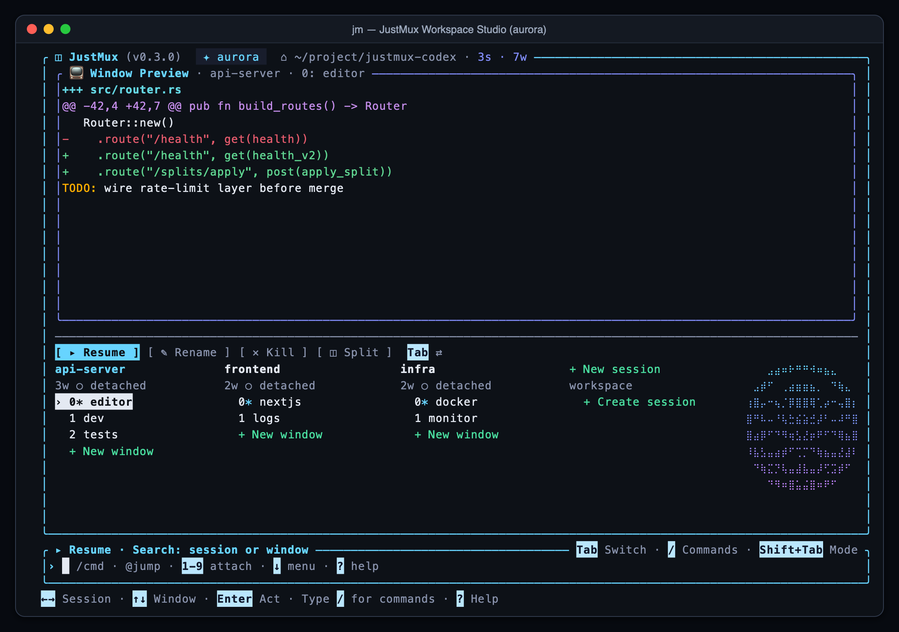
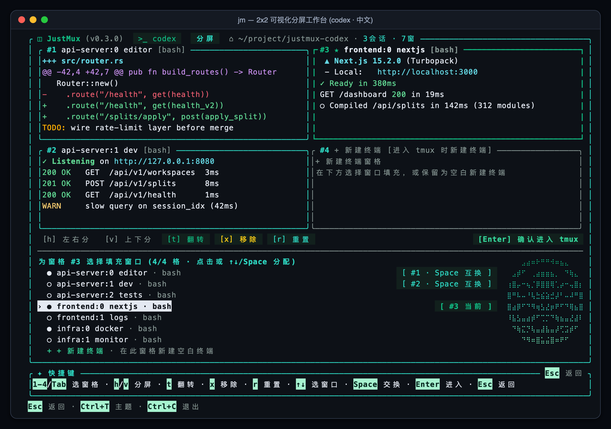
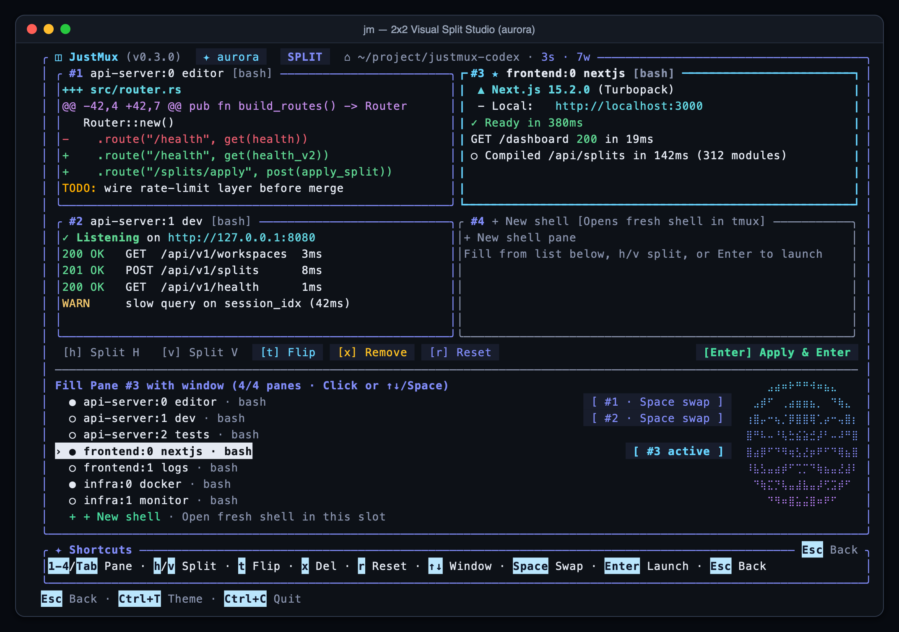
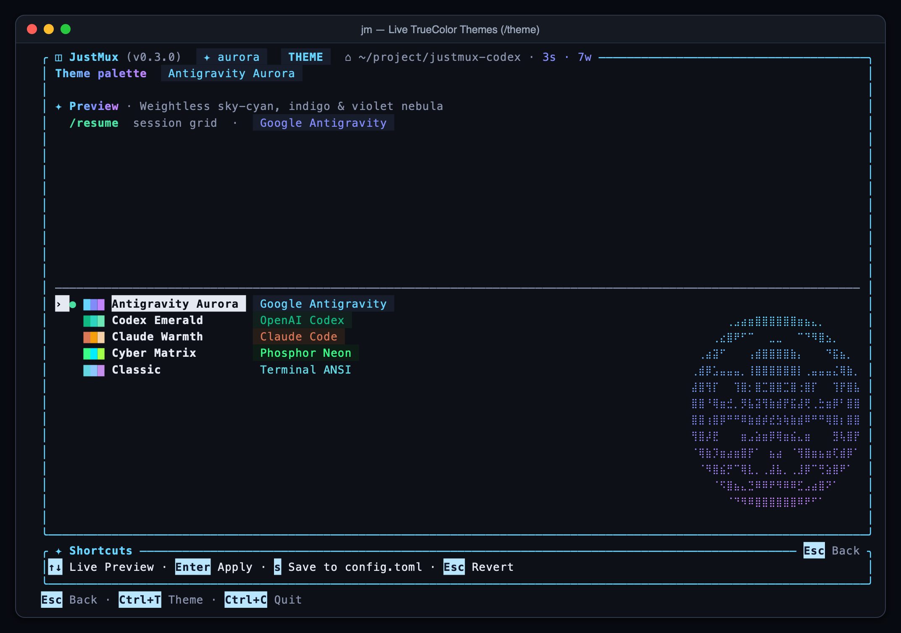

<div align="center">

# ◫ JustMux (`jm`)

### tmux 很好用，但背 `Ctrl+b %`、`Ctrl+b "`、`Ctrl+b s` 真的很累。现在，只需敲一个 `/`。

**一个直接长在你现有 tmux 上的高颜值可视化工作台 + 2×2 分屏编排器。**

[](https://www.npmjs.com/package/justmux)
[](LICENSE)
[](#15-秒快速上手)
[](#更多细节与开发说明)

[English](README.md) · **简体中文**

```sh
curl -fsSL https://raw.githubusercontent.com/Quaternijkon/justmux/main/install.sh | sh
# 或通过 npm 安装（需 Node.js 22.15+）：
npm install -g justmux@latest
jm
```

<br />



</div>

---

## 为什么 tmux 老用户用过 `jm` 就回不去？

tmux 保活会话是神器，但平时切窗、找日志、拼分屏的体验实在太原始了：

- **“开了 6 个 detached session，到底哪个里面在跑报错日志？”**
  以前只能一个个 attach 进去看一眼再 detach。在 `jm` 里，不用进入会话就能直接看到每个 window 和 pane 的 **自动流式刷新 ANSI 真彩画面**——配备带琥珀色搜索命中刻度与红色 `ERROR`/`FATAL`/`panic` 错误刻度的 **VS Code 滚动条**、支持**划词拖拽复制**、**`[`/`]` 切换多窗格预览**、关键词**搜索（`f`）**、一键**复制（`y`）**、日志导出 / `pipe-pane`，还能按 **`Ctrl+G` / `F3`** 打开 **Mission Control（`/expose`）** 全景监控墙，用输出活跃度 **Sparkline 波形** 一眼扫完所有窗口。
- **“能不能直接在预览里敲命令或发 Ctrl+C，不用切进切出？”**
  点击顶部菜单栏的 **`[⌨ PIP]`**（或任意预览卡 / Exposé 卡片右上角的 **`[⌨]`**，或在 `/expose` 中按 **`i`**）即可开启 **Live PIP 实时直控输入**：键盘输入、粘贴文本甚至 **`Ctrl+C`** 都会直接透传到后台窗格并以 80ms 刷新画面；按 **`Esc`** 随时退回控制台，点击 **`[发送 Esc]`** 则可向窗格发送真实 Esc 键。
- **“想拼 2×2 分屏、调比例、或者临时放大一个窗格，在原生 tmux 里总能按歪。”**
  再也不用死记 `Ctrl+b %`、`Ctrl+b "`、`Ctrl+b Alt+1..5` 和 `Ctrl+b z`。直接**鼠标拖拽任意窗口**到预览卡、分屏格或 Exposé 卡片的 **左/右/上/下边缘停靠区** 即可原地分屏，还能直接**拖动分屏分隔线（Sash）** 实时调整比例！敲 **`/split`** 打开 **2×2 可视化分屏工作台**（支持编辑已有 2–4 窗格布局、`50/50 · 70/30 · 30/70` 比例、`g` 预设网格、**`y` 同步广播输入**与 **`b` 独立拆出窗格**），或敲 **`/layout`** 可视化套布局与调尺寸。
- **“屏幕四周全是点阵边框（被其他终端锁小了），或者想把整套开发环境布局存成模板？”**
  打开 **`/clients`** 一眼看清所有附着客户端分辨率，按 **`d`**（或 **`o`**）一键踢出其他客户端立刻恢复满屏（会话操作里还提供**只读观摩 Attach Read-Only**）。用 **`/buffers`** 可视化管理与粘贴 tmux 剪贴板缓冲区，用 **`/snapshot`** 将多会话、窗口、工作目录、窗格标题、布局与同步状态保存为纯 TOML 快照并随时一键恢复。
- **“我已经进到 Vim / Codex CLI / Claude Code / agy 里了，不想退出来怎么切 window？”**
  直接在 **`/config`** 中开启 **`tmux_popup`**（无需手改 `.tmux.conf`，自动写入并热加载 **`Ctrl+b j`**）：无论在普通终端还是任何全屏程序里，随时在当前界面上方悬浮弹出 `jm`；选好 window 按回车直接跳过去，按 `Esc` 关窗，原本运行中的程序纹丝不动。想临时弹个浮窗终端？直接输入 **`/popup`**（tmux 3.2+）。
- **“不想装一堆 TPM 插件、不想跑后台 daemon、更不想别人乱改我的 `.tmux.conf`。”**
  纯 Rust 单二进制、零后台常驻进程、零数据库；除非你主动在 **`/config`** 开启 **`tmux_popup`** 或 5 项新手友好舒适开关（**`tmux_mouse`**、**`tmux_history_limit`**、**`tmux_base_index_one`**、**`tmux_renumber_windows`**、**`tmux_zero_escape_time`**），否则绝不会修改你的 `~/.tmux.conf`。

---

## 实机界面一览

### 1. 2×2 可视化分屏工作台：在终端里体验 GUI 级分屏手感

输入 `/split`（或在首页按 `Tab` 切到 `[ ◫ Split ]`）即可先在画布里排兵布阵，确认好再动手改 tmux：

<div align="center">
  
</div>

<details>
<summary>点击展开英文界面与按键说明</summary>
<br />
<p align="center">
  
</p>
</details>

- **可视化拆格、编辑已有分屏或一键套网格**：用鼠标点击任意窗格（或按 **`1`–`4`** / **`Tab`**）切焦点；按 **`h`** 左右拆分、**`v`** 上下拆分、**`t`** 翻转布局、**`p`** 循环切换比例（`50/50 · 70/30 · 30/70`）或 **`[`/`]`** 以 5% 微调、**`g`** 切换快捷网格预设（`1×2`、`2×1`、`主屏+2`、`2×2`）、**`x`** 移除选中格、**`r`** 重置。对已有 2–4 个窗格的窗口打开 `/split`，会自动还原真实分屏供你继续调整，还能按 **`b`** 直接把选中窗格独立拆成新窗口！
- **填入现有窗口 & 同步输入安全提醒**：用 **`↑↓`** 或鼠标点击下方列表分配窗口（`+ 新建终端` 会开启新 shell）。浏览时不会误抢已占用窗口，按 **`Space`** 或点击即可互换位置；按 **`y`** 可开关 **`synchronize-panes`**（开启时顶部会高亮显示醒目的同步输入警告条）。
- **每个分屏格里直接带实时预览**：不用盲拼，直接看得到里面正在跑什么，悬停鼠标滚轮或按 `PgUp`/`PgDn` 还能在格子里翻日志。
- **反悔零成本**：按 **`Enter`**（或点击 `[Enter] 确认进入 tmux`），`jm` 自动调用原生 `join-pane` / `split-window` / `resize-pane` 排好布局并聚焦到你高亮选中的那一格；如果按 **`Esc`** 放弃，对原生 tmux 没有任何副作用。

---

### 2. 桌面级终端 GUI 与零记忆 tmux 控制器

JustMux 在终端内带来原生桌面 IDE 般的交互体验——配备 **顶部 IDE 菜单栏**（左侧 `[⌂ Studio]` · `[⊞ Expose]` · `[◫ Split]` · `[▦ Layout]` · `[≡ Menu ▾]` 下拉菜单；右侧实时活跃度 **Sparkline**、`[⌨ PIP]`、`[🎨]`、一键 **`[中/EN]`** 语言切换、`[⚙]` 与 `[⏏]`）、完整桌面鼠标手势以及支持模糊搜索的 **`/`** 命令面板（空栏 `↓` 或任意界面 `Ctrl+P`）：

<div align="center">
  
</div>

- **完整桌面级鼠标手势、拖拽停靠与悬浮浮层**：
  - **单击**聚焦并刷新预览，避免误跳；**双击（`<= 350ms`）** 立刻进入 tmux；**中键点击**打开 `yes` 关闭确认（在分屏工作台中直接移除槽位）；在任意会话、窗口、窗格、预览卡、分屏格或背景上 **右键点击** 弹出带 2D 投影与背景暗幕的 **悬浮右键菜单**。
  - **VS Code 风格拖拽 & 悬浮幽灵卡片**：按住拖拽窗口跨会话移动（`move-window`）或同会话调序（`swap-window`），拖到预览卡、分屏格或 Exposé 卡片的 **左/右/上/下/中心 5 区边缘停靠区** 即可原地分屏停靠；在主页、`/split` 与 `/layout` 中还可直接 **拖拽分隔线（Sash）** 实时调整比例并显示 `64% │ 36%` 浮标。
  - **VS Code 滚动条、划词复制与行内重命名**：拖动或点击预览卡右侧带琥珀色搜索刻度与红色 `ERROR`/`FATAL`/`panic`/`FAIL` 错误刻度的滚动条；在预览正文区域直接按住拖动即可划词选区并松手复制纯文本；按 **`F2`**（或点击 **`[✎]`**）弹出预填当前名称的悬浮重命名框；所有操作均附带右下角倒计时进度条 **Toast 提示卡**。
- **Mission Control 全景墙（`/expose`、`Ctrl+G`、`F3`）与 Live PIP 实时直控**：
  - 打开 **`/expose`** 浏览 `1×1`–`3×3` 多窗口实时 ANSI 画面墙，每格带输出速度 **Sparkline（`▁▂▃▅▇█`）**、状态徽标以及悬停高亮的红黄绿风格窗口控制按钮 **`[⌨][⛶][✕]`**。
  - 点击 **`[⌨ PIP]`** / **`[⌨]`**（或在 `/expose` 中按 **`i`**）进入 **Live PIP 直控模式**：所有键入、粘贴与 `Ctrl+C` 直接发往后台窗格并实时刷新预览；按 **`Esc`** 退出直控，点击 **`[发送 Esc]`** 向窗格发送原生 Esc。
- **`Shift+Tab` 三种主页模式 + 全套状态徽标**：在 **命令 & `@跳转`**（横向矩阵 + `1–9` 直达 + `⛶` 缩放、`⚡SYNC` 同步、`●`/`🔔`/`💤` 活动/响铃/静默提醒、`✕` 已退出窗格、`👥 N` 多端人数徽标）、**实时雷达（Live Radar）** 与 **快速启动（Quick Launch）** 间自由切换。窗口有多个窗格时，在首页直接按 **`[`/`]`**（或点击 **`◀`/`▶`**）即可轮播查看每个窗格的实时画面。
- **预览搜索、复制与日志录制一气呵成**：任意实时预览卡均可按 **`f`** 关键词搜索（`n`/`N` 跳转匹配）、按 **`y`** 复制到系统剪贴板（支持 `pbcopy`/`wl-copy`/`xclip`/`xsel`，SSH 无头环境自动回退到 tmux 缓冲区），点击 **`[日志]`** / **`[录流]`** 可导出纯文本日志或开关 `pipe-pane` 实时落盘。
- **针对 tmux 高频痛点的专属可视化工作台**：
  - **`/expose`** — Mission Control 多窗口实时全景预览墙，带 Sparkline 活跃波形、Live PIP（`i`）、缩放（`z`）、行内重命名（`F2`）与拖拽停靠。
  - **`/layout`** — 5 套可视化布局卡片（水平均分、垂直均分、主上副下、主左副右、网格平铺）+ 方向键与拖拽分隔线实时 **`resize-pane`** 面板 + **`z`** 缩放与 **`s`** 同步开关。
  - **`/clients`** — 查看所有已附着客户端与窗口分辨率，按 **`d`**（或 **`o`**）一键**踢出其他客户端恢复满屏**（根治点阵边框），按 **`x`** 分离选中客户端，并支持在会话操作里选择**只读附着（Attach Read-Only）**。
  - **`/buffers`** — 浏览 tmux 粘贴缓冲区与完整内容预览，支持粘贴到指定窗格（`Enter`）、复制到系统剪贴板（`y`）、新建（`n`）与删除（`x`）。
  - **`/snapshot`** — 一键保存（`n`）与恢复（`Enter`）工作区快照（完整记录会话、窗口、各窗格工作目录、标题、布局与同步开关），以纯零依赖 TOML 持久化存储。
  - **`/pane` 与 `/window`** — 丰富的上下文菜单：全屏缩放、独立拆出、互换/合并窗格、跨会话移动/链接/重排窗口、活动/静默监控循环切换、发送 `Ctrl+C` 或命令（`send-keys`）、清空滚动历史、重启已退出窗格（`respawn-pane`）、重命名窗格标题，以及支持按 `Tab` 填写可选工作目录的新建窗口表单。
  - **`/popup` 与 `/kill-server`** — 一键弹出原生悬浮临时终端（tmux 3.2+），或通过严格 `yes` 二次确认安全关闭整个 tmux 服务。
- **全局 `@` 精准点名 & 自然短语识别**：单独输入 `@` 或在 `/kill`、`/rename`、`/split`、`/layout` 后接 `@` 精准定位目标；直接输入 `expose`、`mission control`、`zoom`、`break pane`、`sync panes`、`detach others`、`clients`、`buffers`、`save workspace`、`restore workspace`、`reload tmux`、`popup` 等短语也能直达——高危操作一律弹出 `yes` 确认卡防手滑。
- **几个开发彩蛋**：试试 `/codex`、`/claude`、`/antigravity`、`/vibe`，或者在主页习惯性按下 `Ctrl+b`，会有惊喜文案。

---

### 3. 五套高颜值真彩主题 + 原生中英文无缝切换

随时按 **`Ctrl+T`** 一键切换 **Antigravity Aurora**、**Codex Emerald**、**Claude Warmth**、**Cyber Matrix** 与 **Classic** 配色；或者进 `/theme` 实时对比预览后按 `s` 存盘，也能在 `/config` 里一键切换 **English / 简体中文**：

<table>
  <tr>
    <td width="50%">
      
      <p align="center"><sub><code>/theme</code> — 5 套真彩配色实时预览，按 <code>s</code> 持久化到配置</sub></p>
    </td>
    <td width="50%">
      
      <p align="center"><sub><code>language = "zh"</code> — 菜单、帮助、快捷键胶囊与分屏全部原生汉化</sub></p>
    </td>
  </tr>
</table>

---

## 15 秒快速上手

### 一键原生安装（无需 Node.js，也无需 Rust 环境）

```sh
curl -fsSL https://raw.githubusercontent.com/Quaternijkon/justmux/main/install.sh | sh
jm        # 也可以用：justmux
```

> 自动下载对应平台预编译二进制（**macOS Apple Silicon** 或 **Linux x64** 静态 musl），校验 SHA-256 后将 `jm` 与 `justmux` 直接安装到 `PATH` 中的可写目录（若当前无目录可用则落盘到 `~/.local/bin` 并自动写入 shell `PATH` 配置）。

### 或通过 npm 一键安装（需 Node.js 22.15+）

```sh
npm install -g justmux@latest
jm        # 也可以用：justmux
```

> `jm` 和 `justmux` 指向同一个 Rust 原生应用（Node 仅在启动时通过 `execve` 无缝替换为二进制并退出，不占内存）。安装时会运行纯本地 `postinstall` 助手，确保 `jm` / `justmux` 已链接到 `<prefix>/bin` 且在 `PATH` 中直接可用（当 npm 全局前缀不在 `PATH` 中或开启了 `bin-links=false` 时，会自动在 `/usr/local/bin`、`~/.local/bin` 等已有的 `PATH` 目录建立软链，且绝不覆盖同名外部程序）。若在启用 `--ignore-scripts`、或使用 `pnpm` / `bun` 时遇到 `command not found`，请将 `$(npm prefix -g)/bin` 加入 `PATH` 或直接改用上方一键原生安装脚本。日后想升级只需运行 **`jm update`**。

### 或者通过 Cargo 源码编译安装（Rust 1.88+）

```sh
cargo install --path . --locked
```

---

## 强烈推荐神技：在 Vim / Codex / Claude / agy 里“浮窗直跳”

当你已经进入 tmux，并且正在全屏跑着 `vim`、`agy`、`claude`、`codex` 这种接管终端输入的程序时，不需要退出它：

**设置内一键开启（推荐）：** 在 JustMux 里输入 **`/config`**，选到 **`tmux_popup`** 按 **`Space`** / **`Enter`**，JustMux 会自动在 `~/.tmux.conf`（或已有的 `~/.config/tmux/tmux.conf`）写入托管区块并向当前运行的 tmux 服务热加载，无论身处普通终端还是 `agy` 内部都能立刻生效；再按一次即可无痕移除，绝不影响你的其余配置。在 **`/config`** 下方还提供 5 项一键开启的 `~/.tmux.conf` 舒适开关（**`tmux_mouse`** 鼠标支持、**`tmux_history_limit`** 滚动历史行数、**`tmux_base_index_one`** 编号从 1 开始、**`tmux_renumber_windows`** 自动重排窗口号、**`tmux_zero_escape_time`** 消除 Esc 延迟）以及 **`tmux_reload`** 一键热重载配置。

也可以运行 `jm --print-keybind`，手动把这一行放进你的 `~/.tmux.conf`（需要 tmux 3.2+）：

```tmux
bind-key j run-shell 'tmux display-popup -E -w 80% -h 70% -c #{q:client_name} "JUSTMUX_CLIENT=#{q:client_name} JUSTMUX_PANE=#{q:pane_id} JUSTMUX_POPUP=1 jm"'
```

开启后（或手动 `tmux source-file ~/.tmux.conf` 后），在任何终端或程序里按 **`Ctrl+b` 再按 `j`**：

1. 屏幕中央直接悬浮弹出 `jm`；
2. 选好要去的 window（或用 `/split` 拼好分屏）按 **`Enter`**，立刻通过 `switch-client` 切换过去；
3. 按 **`Esc`** 关闭弹窗，原封不动回到刚才正在写的界面。

---

## 常用按键速查表

| 你想做什么 | 这样按 |
| --- | --- |
| 数字键直达第 1–9 个会话 | 空栏直接按 **`1`–`9`**、方向键选中按 **`Enter`** 或 **双击（`<= 350ms`）** |
| 打开 Mission Control 多窗口全景墙 | **`/expose`** · **`Ctrl+G`** · **`F3`** · 点击 **`[⊞ Expose]`**（`i` 直控 · `z` 缩放 · `F2` 重命名 · `x` 关闭） |
| Live PIP 直接向后台窗格输入 | **`F4`** · 点击 **`[⌨ PIP]`** / **`[⌨]`**（或在 `/expose` 按 **`i`**）· 键入/粘贴/`Ctrl+C` · **`Esc`** 退出（`[发送 Esc]` 发送 Esc） |
| 桌面鼠标手势与 VS Code 拖拽 | **右键** 悬浮菜单 · **中键** 关闭 · **拖拽** 移动/互换/边缘停靠分屏 · **拖分隔线** 调比例 |
| 快速行内重命名会话 / 窗口 / 窗格标题 | **`F2`** 或点击 **`[✎]`** |
| 打开 2×2 可视化分屏工作台 | **`/split`**（或点击 **`[◫ Split]`** / 首页 **`Tab`** 切到 `[分屏]` / **`/split @目标`**） |
| 在分屏工作台里排布与调比例 | **`1-4`/`Tab`/点击** 选格 · **`h`/`v`** 拆分 · **`t`** 翻转 · **`p`/`[`/`]`** 比例 · **`g`** 预设网格 · **`y`** 同步输入 · **`b`** 拆出窗格 · **`x`** 移除 · **`r`** 重置 · **`Space`** 交换 |
| 可视化布局与实时调整窗格大小 | **`/layout`**（**`1-5`** 套用预设 · **`←→↑↓`** 或拖分隔线调尺寸 · **`+/-`** 步长 · **`z`** 缩放 · **`s`** 同步） |
| 滚动、划词复制、搜索、复制与录日志 | 滚动条 / 滚轮 / **`PgUp`/`PgDn`** · **划词拖拽复制** · **`[`/`]`** 切窗格 · **`f`** 搜索（`n`/`N`）· **`y`** 复制 · **`[日志]`/`[录流]`** |
| 解除点阵边框 / 管理附着客户端 | **`/clients`**（**`d`/`o`** 踢出其他端恢复全屏 · **`x`/`Enter`** 分离选中端 · **`K`** 关闭服务） |
| 管理粘贴缓冲区与工作区快照 | **`/buffers`**（`Enter` 粘贴 · `y` 复制 · `n` 新建 · `x` 删除）· **`/snapshot`**（`n` 保存 · `Enter` 恢复 · `x` 删除） |
| 弹出原生悬浮临时终端 | **`/popup`**（tmux 3.2+） |
| 切换主页视图模式 | **`Shift+Tab`**（命令跳转 / 实时雷达 / 快速启动） |
| 任意位置呼出命令菜单 | **`/`** · 空栏 **`↓`** · **`Ctrl+P`** · 非输入态 **`Ctrl+K`** · 点击 **`[≡ Menu ▾]`** |
| 切换主题、语言与 `tmux.conf` 舒适项 | **`Ctrl+T`** / **`[🎨]`** · 点击 **`[中/EN]`** · **`/theme`** · **`/config`**（按 **`s`** 保存，含 `live_stream`、`tmux_*` 与 `[立即重载]`） |
| 分离当前会话 vs 退出 JustMux | 点击 **`[⏏]`** / **`[ ⏏ 分离 ]`** 或 **`/exit`**（仅 detach 客户端）· **`/quit`** 或 **`Esc`**（关闭 `jm`） |

---

## 更多细节与开发说明

<details>
<summary><strong>运行要求、原生 <code>--inline</code> 模式、自定义 Socket 与更新检查</strong></summary>

- **运行环境**：本地已安装 `tmux`（悬浮弹窗建议 3.2+，macOS 可用 `brew install tmux`，Debian/Ubuntu 用 `sudo apt install tmux`）；若走 npm 全局安装需 Node.js `22.15+`（推荐 Node 24 LTS）。
- **喜欢保留原终端滚屏历史？** 加参数 `jm --inline`（或在 `/config` 中将 `screen_mode` 设为 `inline`），只在终端底部开辟紧凑交互区，绝不切换备用屏幕或抢占终端滚轮。同时支持 `NO_COLOR=1`、`TERM=dumb` 与 `--ascii`。
- **零依赖 TOML 配置**：配置文件路径为 `~/.config/justmux/config.toml`（优先级 `命令行参数 > 环境变量 > config.toml > 默认值`）。用 `jm --print-config` 导出默认配置模板，`jm doctor` 检查当前终端与配置诊断信息。详见 [`docs/configuration.md`](docs/configuration.md)。
- **自定义 tmux socket**：和原生 tmux 一样支持 `jm -L NAME` 与 `jm -S /path/to/socket`。
- **每日一次温和更新提醒**：仅在通过 npm 全局安装且交互式启动时，每天最多检查一次更新（可通过 `JUSTMUX_NO_UPDATE_CHECK=1` 关闭，或随时运行 `jm update --check` / `jm update`）。

</details>

<details>
<summary><strong>贡献代码、自动化测试与本地构建</strong></summary>

所有集成测试均在私有隔离 socket 上运行并自动清理，绝不干扰默认 tmux 服务或 `~/.tmux.conf`。真机终端烟雾录屏参见 [`assets/demo.cast`](assets/demo.cast)，手工检查清单见 [`docs/manual-test.md`](docs/manual-test.md)。

```sh
export PATH="$HOME/.cargo/bin:$PATH"
cargo fmt --all -- --check
cargo clippy --all-targets --all-features -- -D warnings
cargo test --all
cargo build --release
```

npm 启动器测试、发版工作流检查及 PTY 回归测试（说明另见 [`docs/npm-release.md`](docs/npm-release.md) 与 [`docs/local-release.md`](docs/local-release.md)）：

```sh
npm --prefix npm/justmux test
node --test tests/npm-packages.test.mjs tests/release-workflow.test.mjs
python3 scripts/pty_smoke.py
```

</details>

## 开源协议

MIT © [Quaternijkon](https://github.com/Quaternijkon/justmux)
