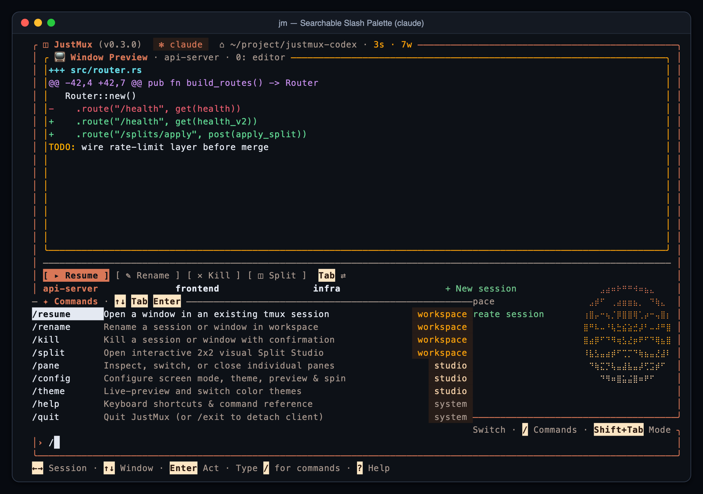

<div align="center">

# ◫ JustMux (`jm`)

### tmux 很好用，但背 `Ctrl+b %`、`Ctrl+b "`、`Ctrl+b s` 真的很累。现在，只需敲一个 `/`。

**一个直接长在你现有 tmux 上的高颜值可视化工作台 + 2×2 分屏编排器。**

[](https://www.npmjs.com/package/justmux)
[](LICENSE)
[](#15-秒快速上手)
[](#更多细节与开发说明)

[English](README.md) · **简体中文**

```sh
npm install -g justmux@latest
jm
```

<br />


</div>

---

## 为什么 tmux 老用户用过 `jm` 就回不去？

tmux 保活会话是神器，但平时切窗、找日志、拼分屏的体验实在太原始了：

- **“开了 6 个 detached session，到底哪个里面在跑报错日志？”**
  以前只能一个个 attach 进去看一眼再 detach。在 `jm` 里，不用进入会话就能直接看到每个 window 的 **ANSI 真彩实时画面**，甚至能用滚轮 / `PgUp` 直接翻历史输出。
- **“想拼一个像 VS Code 那样的 2×2 分屏，在原生 tmux 里总能拆歪。”**
  再也不用先算清楚要按几下 `Ctrl+b %` 再按几下 `Ctrl+b "`。敲 `/split` 打开 **2×2 可视化分屏工作台**——点一点就能切格、选已有窗口或空白终端填入、即时看每个窗格内容，回车一键落地真实 tmux 并自动聚焦到你选的那一块。
- **“我已经进到 Vim / Codex CLI / Claude Code / agy 里了，不想退出来怎么切 window？”**
  给 `~/.tmux.conf` 加一行 **`Ctrl+b j`** 弹窗绑定：无论在什么全屏程序里，随时在当前界面上方悬浮弹出 `jm`；选好 window 按回车直接跳过去，按 `Esc` 关窗，原本运行中的程序纹丝不动。
- **“不想装一堆 TPM 插件、不想跑后台 daemon、更不想别人乱改我的 `.tmux.conf`。”**
  纯 Rust 单二进制、零后台常驻进程、零数据库，只在你启动 `jm` 时向本地 tmux 发起调用，选完即走、彻底把终端还给 tmux。

---

## 实机界面一览

### 1. 2×2 可视化分屏工作台：在终端里体验 GUI 级分屏手感

输入 `/split`（或在首页按 `Tab` 切到 `[ ◫ Split ]`）即可先在画布里排兵布阵，确认好再动手改 tmux：

<div align="center">
  
</div>

<details>
<summary>点击展开英文界面与按键说明</summary>
<br />
<p align="center">
  
</p>
</details>

- **最多 2 列 × 2 行（4 窗格），点选与键盘都很顺手**：用鼠标点击任意窗格（或按 **`1`–`4`** / **`Tab`**）切焦点；按 **`h`** 左右拆分、**`v`** 上下拆分、**`t`** 一键翻转横向/纵向布局、**`x`** 移除选中格、**`r`** 重置回 1×1。
- **把现有窗口“灌”进分屏，或者留白新建**：用 **`↑↓`** 或鼠标点击下方的窗口列表就能分配窗格（`+ 新建终端` 会开启新 shell）。浏览过程中不会误抢已占用的窗口，按 **`Space`** 或直接点击即可互换位置。
- **每个分屏格里直接带实时预览**：不用盲拼，直接看得到里面正在跑什么，悬停鼠标滚轮或按 `PgUp`/`PgDn` 还能在格子里翻日志。
- **反悔零成本**：按 **`Enter`**（或点击 `[Enter] 确认进入 tmux`），`jm` 自动调用原生 `join-pane` / `split-window` 排好布局并聚焦到你高亮选中的那一格；如果按 **`Esc`** 放弃，对原生 tmux 没有任何副作用。

---

### 2. 不用再死记指令：敲一个 `/` 就能搜到所有功能

忘记命令或名字？按下 **`/`**（空输入时按 **`↓`**，或任意界面按 **`Ctrl+P`**）立刻唤出带分组徽标、支持拼音前缀/模糊匹配与拼写纠错的命令面板：

<div align="center">
  
</div>

- **`Shift+Tab` 三种主页模式随便切**：在 **命令 & `@跳转`**（横向工作区矩阵 + `1–9` 数字直达）、**实时雷达（Live Radar）**、以及 **快速启动（Quick Launch）** 之间无缝切换。
- **全局 `@` 精准点名**：单独输入 `@`，或在 `/kill`、`/rename`、`/split` 后面接 `@`，自动联想 `@session`、`@session:window` 和 `@session:window.pane`。
- **说人话也能懂 & 高危操作防手滑**：直接输入 `new demo`、`split right`、`kill demo` 或不带斜杠的 `resume` 都能识别；关闭会话/窗口时一定会弹出确认卡，必须输入 `yes` 才会执行。
- **几个开发彩蛋**：试试 `/codex`、`/claude`、`/antigravity`、`/vibe`，或者在主页习惯性按下 `Ctrl+b`，会有惊喜文案。

---

### 3. 五套高颜值真彩主题 + 原生中英文无缝切换

随时按 **`Ctrl+T`** 一键切换 **Antigravity Aurora**、**Codex Emerald**、**Claude Warmth**、**Cyber Matrix** 与 **Classic** 配色；或者进 `/theme` 实时对比预览后按 `s` 存盘，也能在 `/config` 里一键切换 **English / 简体中文**：

<table>
  <tr>
    <td width="50%">
      
      <p align="center"><sub><code>/theme</code> — 5 套真彩配色实时预览，按 <code>s</code> 持久化到配置</sub></p>
    </td>
    <td width="50%">
      
      <p align="center"><sub><code>language = "zh"</code> — 菜单、帮助、快捷键胶囊与分屏全部原生汉化</sub></p>
    </td>
  </tr>
</table>

---

## 15 秒快速上手

### npm 一键安装（自带预编译原生二进制，无需配置 Rust 环境）

```sh
npm install -g justmux@latest
jm        # 也可以用：justmux
```

> `jm` 和 `justmux` 指向同一个 Rust 原生应用（Node 仅在启动时通过 `execve` 无缝替换为二进制并退出，不占内存）。日后想升级只需运行 **`jm update`**。现已预编译支持 **macOS Apple Silicon (ARM64)** 与 **Linux x64**（静态链接 musl）。

### 或者通过 Cargo 源码编译安装（Rust 1.88+）

```sh
cargo install --path . --locked
```

---

## 强烈推荐神技：在 Vim / Codex / Claude / agy 里“浮窗直跳”

当你已经进入 tmux，并且正在全屏跑着 `vim`、`agy`、`claude`、`codex` 这种接管终端输入的程序时，不需要退出它：

运行 `jm --print-keybind`，或者把这一行放进你的 `~/.tmux.conf`（需要 tmux 3.2+）：

```tmux
bind-key j run-shell 'tmux display-popup -E -w 80% -h 70% -c #{q:client_name} "JUSTMUX_CLIENT=#{q:client_name} JUSTMUX_PANE=#{q:pane_id} JUSTMUX_POPUP=1 jm"'
```

重载配置一次（`tmux source-file ~/.tmux.conf`），之后在任何程序里按 **`Ctrl+b` 再按 `j`**：

1. 屏幕中央直接悬浮弹出 `jm`；
2. 选好要去的 window（或用 `/split` 拼好分屏）按 **`Enter`**，立刻通过 `switch-client` 切换过去；
3. 按 **`Esc`** 关闭弹窗，原封不动回到刚才正在写的界面。

---

## 常用按键速查表

| 你想做什么 | 这样按 |
| --- | --- |
| 数字键直达第 1–9 个会话 | 空栏直接按 **`1`–`9`**，或方向键选中按 **`Enter`** |
| 打开 2×2 可视化分屏工作台 | **`/split`**（或在首页 **`Tab`** 切到 `[分屏]` / **`/split @目标`**） |
| 在分屏工作台里排布窗格 | **`1-4`/`Tab`/鼠标点击** 选窗格 · **`h`** 左右分 · **`v`** 上下分 · **`t`** 翻转 · **`x`** 移除 · **`r`** 重置 · **`Space`** 交换 |
| 滚动查看实时终端日志预览 | 鼠标悬停滚轮 · **`PgUp`/`PgDn`** · **`Home`/`End`** · **`Ctrl+U`/`Ctrl+D`** |
| 切换主页视图模式 | **`Shift+Tab`**（命令跳转 / 实时雷达 / 快速启动） |
| 任意位置呼出命令菜单 | **`/`** · 空栏 **`↓`** · **`Ctrl+P`** · 非输入态 **`Ctrl+K`** |
| 切换主题 / 修改与保存设置 | **`Ctrl+T`** / **`/theme`** / **`/config`**（按 **`s`** 保存至 `~/.config/justmux/config.toml`） |
| 分离当前会话 vs 退出 JustMux | **`/exit`**（仅 detach 客户端）· **`/quit`** 或 **`Esc`**（关闭 `jm`） |

---

## 更多细节与开发说明

<details>
<summary><strong>运行要求、原生 <code>--inline</code> 模式、自定义 Socket 与更新检查</strong></summary>

- **运行环境**：本地已安装 `tmux`（悬浮弹窗建议 3.2+，macOS 可用 `brew install tmux`，Debian/Ubuntu 用 `sudo apt install tmux`）；若走 npm 全局安装需 Node.js `22.15+`（推荐 Node 24 LTS）。
- **喜欢保留原终端滚屏历史？** 加参数 `jm --inline`（或在 `/config` 中将 `screen_mode` 设为 `inline`），只在终端底部开辟紧凑交互区，绝不切换备用屏幕或抢占终端滚轮。同时支持 `NO_COLOR=1`、`TERM=dumb` 与 `--ascii`。
- **零依赖 TOML 配置**：配置文件路径为 `~/.config/justmux/config.toml`（优先级 `命令行参数 > 环境变量 > config.toml > 默认值`）。用 `jm --print-config` 导出默认配置模板，`jm doctor` 检查当前终端与配置诊断信息。详见 [`docs/configuration.md`](docs/configuration.md)。
- **自定义 tmux socket**：和原生 tmux 一样支持 `jm -L NAME` 与 `jm -S /path/to/socket`。
- **每日一次温和更新提醒**：仅在通过 npm 全局安装且交互式启动时，每天最多检查一次更新（可通过 `JUSTMUX_NO_UPDATE_CHECK=1` 关闭，或随时运行 `jm update --check` / `jm update`）。

</details>

<details>
<summary><strong>贡献代码、自动化测试与本地构建</strong></summary>

所有集成测试均在私有隔离 socket 上运行并自动清理，绝不干扰默认 tmux 服务或 `~/.tmux.conf`。真机终端烟雾录屏参见 [`assets/demo.cast`](assets/demo.cast)，手工检查清单见 [`docs/manual-test.md`](docs/manual-test.md)。

```sh
export PATH="$HOME/.cargo/bin:$PATH"
cargo fmt --all -- --check
cargo clippy --all-targets --all-features -- -D warnings
cargo test --all
cargo build --release
```

npm 启动器测试、发版工作流检查及 PTY 回归测试（说明另见 [`docs/npm-release.md`](docs/npm-release.md) 与 [`docs/local-release.md`](docs/local-release.md)）：

```sh
npm --prefix npm/justmux test
node --test tests/npm-packages.test.mjs tests/release-workflow.test.mjs
python3 scripts/pty_smoke.py
```

</details>

## 开源协议

MIT © [Quaternijkon](https://github.com/Quaternijkon/justmux)
